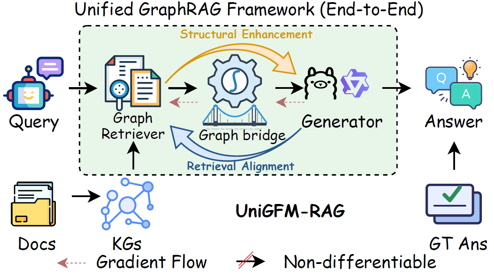

# UniGFM-RAG: Unify Graph Foundation Models and Large Language Models for End-to-End Retrieval and Reasoning, IEEE TKDE 2026

[](https://arxiv.org/abs/2610.34866)
[](https://ieeexplore.ieee.org/stamp/stamp.jsp?arnumber=11790301)


UniGFM-RAG is a unified end-to-end GraphRAG framework that jointly optimizes a **Graph Foundation Model (GFM) retriever** and a **Large Language Model (LLM) generator**. It combines graph reasoning, differentiable graph prefixes, and semantic-guided distillation to align document retrieval with final answer generation.

The framework has three core components:

- **Graph foundation model retriever** utilizes a query-dependent GNN reasons over a heterogeneous graph of entities and documents, combining textual semantics with graph topology to score relevant document nodes.
- **Differentiable graph bridge** transforms retrieved document nodes into soft-weighted graph prefixes and graph-augmented prompts, which injects graph structure into the LLM while allowing answer supervision to back-propagate to the GFM retriever.
- **Semantic-guided distillation** stabilizes GFM training with pseudo-labels derived from query-document semantic similarity, which reduces reliance on *costly fine-grained human annotations*.


The training objective combines answer generation and retrieval distillation:

```math
\mathcal{L} = \mathcal{L}_{\mathrm{gen}} + \lambda D_{\mathrm{KL}}\left(p_{\mathrm{teacher}} \parallel p_{\mathrm{GFM}}\right).
```

Training uses question-answer supervision and semantic pseudo-labels without golden annotations for retrieval. The paper evaluates the framework on three multi-hop QA datasets and three out-of-domain GraphRAG benchmarks.

## Installation

Please refer to [GFM-RAG](https://github.com/RManLuo/gfm-rag).

## Quick Start

Run the following commands from the repository root. Keep the dataset-list variables in the same shell across preprocessing and training.

### 1. Prepare graph-format data

Organize each dataset under `data/<dataset_name>/`:

```text
data/
└── <dataset_name>/
    ├── raw/
    │   └── documents.json
    └── processed/
        └── stage1/
            ├── nodes.csv
            ├── relations.csv
            ├── edges.csv
            ├── train.json  # For training datasets
            └── test.json   # For evaluation datasets
```

The graph index uses the following schema:

| File | Columns | Purpose |
| --- | --- | --- |
| `nodes.csv` | `name,type,attributes` | Entity and document nodes with textual attributes. |
| `relations.csv` | `name,attributes` | Relation names and attributes. |
| `edges.csv` | `source,relation,target,attributes` | Connections between graph nodes. |

Node names must be unique, and edge endpoints and relation names must reference the corresponding graph records. The `attributes` column stores structured attributes as JSON strings, including document text.

Processed QA records contain the question, answer, graph starting nodes, and evaluation targets:

```json
[
  {
    "id": "example-1",
    "question": "Which university employs the author of the cited paper?",
    "answer": "Example University",
    "question_type": "bridge",
    "start_nodes": {
      "entity": ["paper author"]
    },
    "target_nodes": {
      "document": ["Author biography", "Paper details"]
    }
  }
]
```

`start_nodes` and `target_nodes` group graph node names by type. Document targets support retrieval evaluation; the end-to-end retrieval objective uses semantic pseudo-labels. The loader expects both dictionaries, and `target_nodes` can be empty when relevance annotations are unavailable.

### 2. Data preprocessing

The paper uses `Qwen3-Embedding-0.6B` with 1,024-dimensional embeddings. The following dataset list covers the 20 training graph splits from each of HotpotQA, MuSiQue, and 2WikiMultiHopQA:

```bash
UNIGFM_TRAIN_NAMES=()
for dataset in hotpotqa musique 2wikimultihopqa; do
    for split in {0..19}; do
        UNIGFM_TRAIN_NAMES+=("${dataset}_train${split}")
    done
done
UNIGFM_TRAIN_LIST=$(IFS=,; echo "${UNIGFM_TRAIN_NAMES[*]}")

python -m gfmrag.workflow.preprocess \
    datasets.root=./data \
    "train_names=[${UNIGFM_TRAIN_LIST}]" \
    valid_names='[hotpotqa_test,musique_test,2wikimultihopqa_test]' \
    text_emb_model.text_emb_model_name=Qwen/Qwen3-Embedding-0.6B \
    hydra.run.dir=outputs/unigfmrag/preprocess
```

### 3. Train UniGFM-RAG

The paper uses a 6-layer query-dependent GNN with hidden dimension 1,024, a 34M-parameter retriever, and a Qwen3-8B generator. Joint training uses 60,000 queries and 737,310 documents across 60 training graphs.

The following command selects full LLM fine-tuning, initializes the GFM from its architecture configuration, and enables semantic-guided KL distillation:

```bash
torchrun --standalone --nproc_per_node=8 \
    -m gfmrag.workflow.gfm_llm_training \
    datasets.cfgs.root=./data \
    "datasets.train_names=[${UNIGFM_TRAIN_LIST}]" \
    datasets.valid_names='[hotpotqa_test,musique_test,2wikimultihopqa_test]' \
    text_emb_model.text_emb_model_name=Qwen/Qwen3-Embedding-0.6B \
    model.gfm_pretrained_path=null \
    model.llm_model_name_or_path=Qwen/Qwen3-8B \
    model.llm_attn_implementation=sdpa \
    model.enable_lora=false \
    model.freeze_gfm=false \
    model.freeze_llm=false \
    model.loss_type=kl \
    model.weight_type=sigmoid \
    model.alpha=1.0 \
    model.distill_temperature=0.05 \
    optimizer.lr=2e-5 \
    module_lrs.gnn=1e-4 \
    module_lrs.proj=1e-4 \
    topk=5 \
    trainer.args.num_epoch=10 \
    trainer.args.train_batch_size=1 \
    +trainer.args.eval_batch_size=1 \
    wandb.enabled=false \
    hydra.run.dir=outputs/unigfmrag/train
```

The paper trains for 10 epochs on 8 NVIDIA H200 GPUs (141 GB each), with a per-device batch size of 1. Adjust GPU count and training settings to your hardware. LoRA is also supported through `model.enable_lora` and `model.lora_config`.

### 4. Evaluate a trained checkpoint

Use the same model architecture and fine-tuning settings as training. For the full fine-tuning example above, evaluate `model_best.pth` as follows:

```bash
torchrun --standalone --nproc_per_node=1 \
    -m gfmrag.workflow.gfm_llm_training \
    datasets.cfgs.root=./data \
    datasets.train_names='[]' \
    datasets.valid_names='[hotpotqa_test,musique_test,2wikimultihopqa_test]' \
    text_emb_model.text_emb_model_name=Qwen/Qwen3-Embedding-0.6B \
    model.gfm_pretrained_path=null \
    model.llm_model_name_or_path=Qwen/Qwen3-8B \
    model.llm_attn_implementation=sdpa \
    model.enable_lora=false \
    model.freeze_gfm=false \
    model.freeze_llm=false \
    topk=5 \
    trainer.args.resume_from_checkpoint=outputs/unigfmrag/train/model_best.pth \
    trainer.args.do_train=false \
    trainer.args.do_eval=true \
    trainer.args.do_predict=true \
    +trainer.args.eval_batch_size=1 \
    save_pretrained=false \
    wandb.enabled=false \
    hydra.run.dir=outputs/unigfmrag/eval
```

## Reproducing the Results

To reproduce the results reported in the paper, download the datasets and trained model checkpoints from the links below:

- **Datasets:** [Download from OneDrive](https://onedrive.live.com/shared?id=%2Fpersonal%2Fcb4bbdfe5951d1a1%2FDocuments%2FProjects%2FDatasets%2FGFM%2DRAG%2FG%2Dreasoner&listurl=%2Fpersonal%2Fcb4bbdfe5951d1a1%2FDocuments).
- **Model checkpoints:** [Download from Hugging Face](https://huggingface.co/cheng11/UniGFM-RAG).

## Acknowledgements

This implementation builds on [GFM-RAG](https://github.com/RManLuo/gfm-rag). We also thank [ULTRA](https://github.com/DeepGraphLearning/ULTRA), [HippoRAG](https://github.com/OSU-NLP-Group/HippoRAG), and [GraphRAG](https://github.com/microsoft/graphrag) for their contributions to graph reasoning and retrieval-augmented generation.

## Citation

If you find this work useful, please cite:

```bibtex
@ARTICLE{zhao2026unigfmrag,
  author={Zhao, Zicheng and Luo, Linhao and Yu, Zongji and Dong, Junnan and Tan, Yanchao and Pan, Shirui and Gong, Chen},
  journal={IEEE Transactions on Knowledge and Data Engineering}, 
  title={UniGFM-RAG: Unify Graph Foundation Models and Large Language Models for End-to-End Retrieval and Reasoning}, 
  year={2026}
}

```
